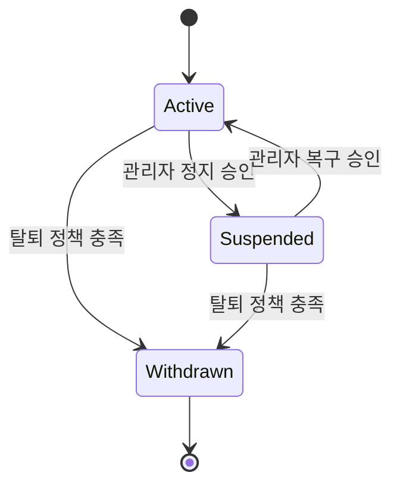
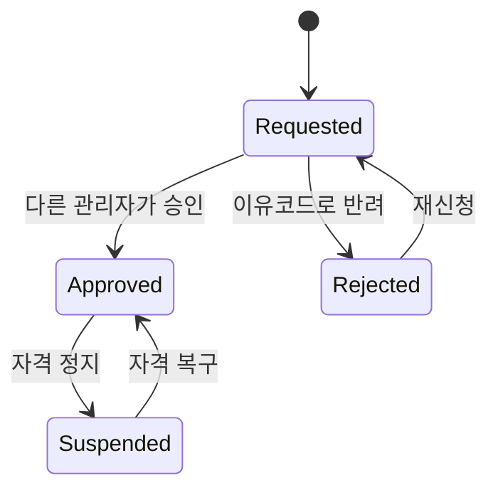
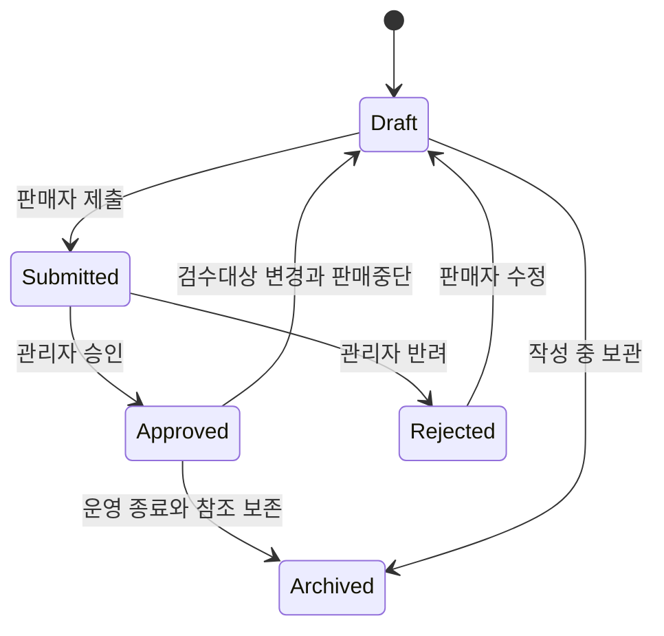
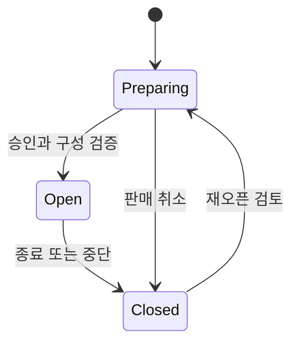
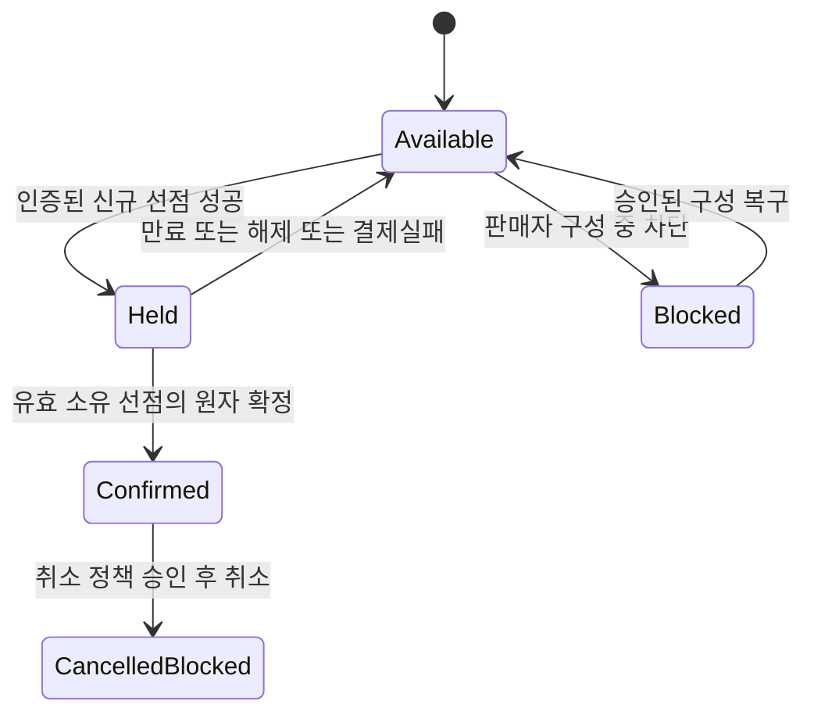
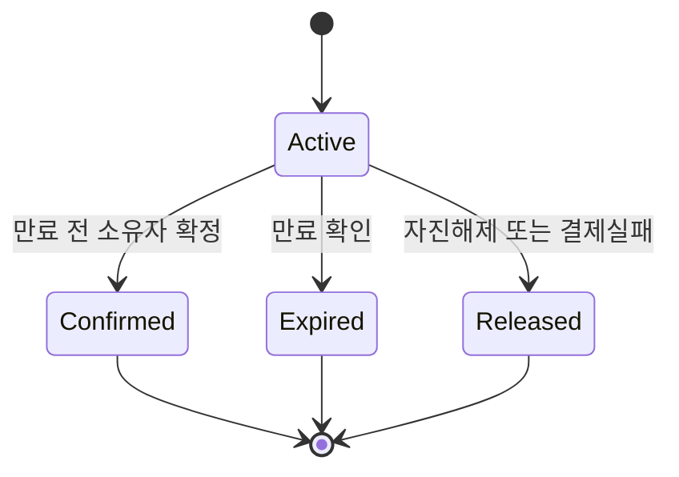
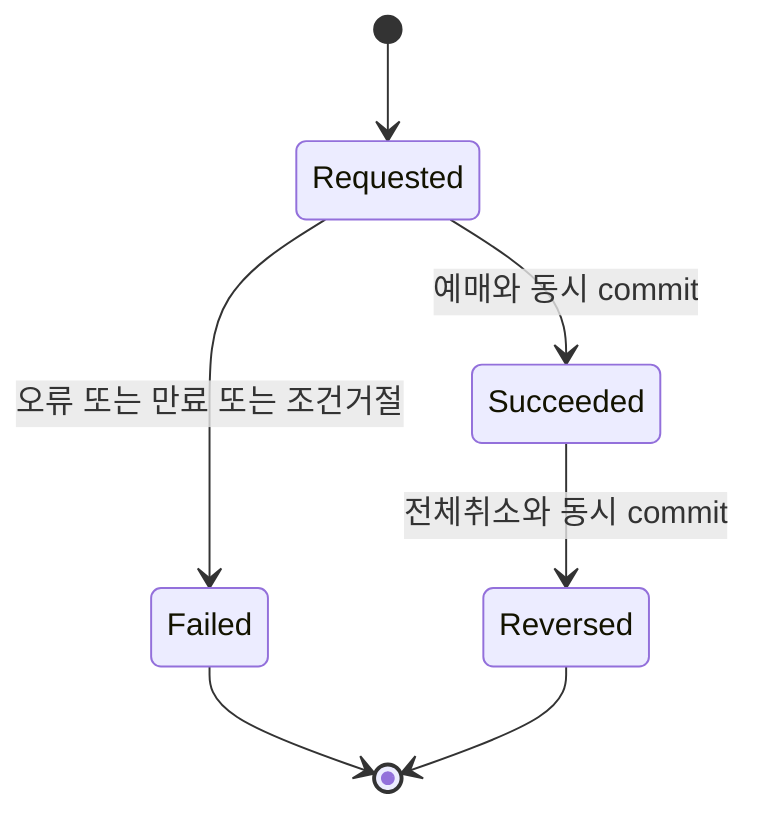
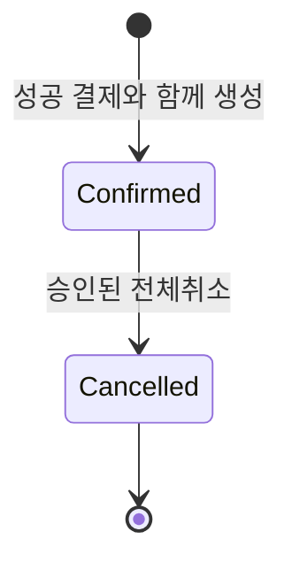
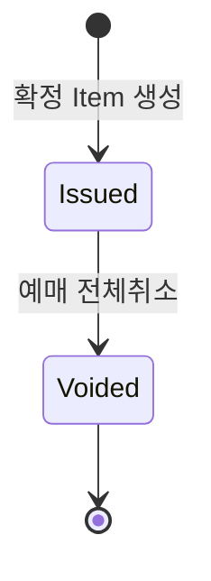

# 도메인 수명주기·정합성 정책 초안

2026-10-28. **승인 전 제안**이며 구현된 상태 모델이 아니다. [목표 논리 ERD](target-logical-erd.md)의 F(확정 요구)·C(기존 사실)·P(새 제안), D1~D8 결정번호를 공유한다. [가이드](../../TICKETING_PROJECT_GUIDE.md)와 [실측 분석](current-schema-analysis.md)을 우선한다.

## 공통 원칙과 시각 기준

- **F**: 같은 회차/좌석의 동시 유효 선점과 확정 예매는 각각 최대 1개. 소유자만 유효 시간 내 확정 가능, 만료 후 확정 불가, 실패 후 좌석 영구 점유 금지, 다른 회차 독립, 중복 요청 멱등성.
- **P**: 모든 판정 명령은 동일한 DB 기준 시각을 사용하고 필요한 락 획득 뒤 단일 decisionAt으로 유효성을 검사한다. `decisionAt < expiresAt`만 유효, 동률은 만료로 보는 안이다. 승인할 기준은 이 직렬화된 판단 순간이며 DB commit 완료 시각과는 다를 수 있다. commit까지 기한 안에 완료해야 한다는 더 강한 요구라면 별도 D3 결정과 구현 검증이 필요하다. 물리 timestamp 타입·UTC 저장 전환은 D5에서 결정한다. 현재 KST/SYSTEM과 LocalDateTime 데이터를 UTC로 조용히 재해석하지 않는다.
- 업무 시각(expiresAt, startsAt, confirmedAt)과 저장/감사 시각(createdAt, recordedAt)을 분리한다. `expiredAt`은 실제 만료 처리 시각으로 expiresAt과 다를 수 있다. 일괄 createdAt/updatedAt/deletedAt 상속은 제안하지 않는다.
- 선점 TTL 숫자, 좌석 수 상한, 금액·통화, 취소 기간·보존 기간은 미정이다. 법적 보존기간이나 실제 PG 정책을 추정하지 않는다.
- 아래 모든 전이는 인증·현재 역할·소유권과 허용 전이 조건을 서버에서 검증하는 안이다. FK에 reviewedBy가 있다고 ADMIN 권한이 증명되는 것은 아니다.

## 회원·역할·판매자·관리자

회원 상태는 ACTIVE/SUSPENDED/WITHDRAWN 제안이다. UserRole은 GRANTED→REVOKED, 승인된 재부여 시 GRANTED로 복구하고 이전 부여·회수는 DomainEvent에 보존한다. 탈퇴를 단순 username unique 삭제로 구현하지 않는다. 기존 username 재사용 허용 여부와 비식별화·FK 유지 방식은 D7이다.

SellerProfile의 REQUESTED/APPROVED/REJECTED/SUSPENDED는 **새 제안**이다. 판매자 승인 자체는 기존 가이드의 공연 검수와 다른 결정이다. 신청 이력·사업자/개인정보 검증은 이번 MVP에 임의로 추가하지 않는다. 복수 역할을 승인하면 자격 승인과 SELLER 권한 부여를 한 트랜잭션, 정지와 회수를 같은 경계로 처리하는 안이다.

ADMIN은 공개 가입/자기 승인을 허용하지 않는다. 기존 관리자의 승인된 부여 또는 최초 1회 별도 통제 절차가 필요하지만 현재 수행하지 않는다. 검토자는 처리 순간 유효 ADMIN이어야 하며 자기 판매자 신청·자기 공연 검수 금지 후보를 둔다. 권한 회수 시 기존 세션과 진행 중 선점의 처리(즉시 차단/일부 유예)는 D1/D3이며 실시간 재검증 또는 권한 버전 검증이 필요하다.

## 공연 검수·판매·회차·가격

- reviewStatus는 DRAFT/SUBMITTED/APPROVED/REJECTED/ARCHIVED 제안. contentVersion=reviewedVersion일 때만 승인 유효로 보는 안이다. 제목/가격/회차/좌석 구성 변경을 어떤 검수 범위로 묶을지는 D6이며 자식 변경도 공연 contentVersion과 검수 효력에 반영해야 한다.
- 최소안의 ARCHIVED는 현재 workflow의 종결 상태로 사용하며 마지막 검수 결과는 reviewedAt/reviewedBy/reviewedVersion 및 전이 event에 보존한다. 보관이 검수 상태를 덮어쓰지 않아야 한다면 archive를 독립 운영 상태로 분리하는 대안을 D6에서 선택한다.
- 공개 목록/상세/회차와 실제 선점·결제는 승인된 버전만 대상으로 한다. 기존 공연을 소유자·검수자 없이 자동 승인하지 않는다. 새로운 검수 규칙을 기존 데이터에 적용하는 이행 방법은 별도 승인한다.
- 승인 철회·판매 중단과 확정이 경합하면 같은 정책 행의 잠금/버전을 통해 한쪽이 먼저 commit되도록 한다. 권한/정책 조회와 재고 변경 사이 간격을 방치하지 않는다.

PerformanceSale의 PREPARING/OPEN/CLOSED는 기존 값을 재사용하되 위 전이 제한·재오픈은 제안이다. 기간 도달과 status는 별개다. 기간이 지났다고 스케줄러의 CLOSED 저장이 완료되어야만 판매를 막는 구조로 만들지 않는다. 가용 판정은 OPEN + 유효 기간 + 승인 + 회차 유효성을 종합한다. 무기간 OPEN 동작과 진행 중 선점의 판매 종료 후 확정 허용 여부는 D3/D5다.

회차 상태 SCHEDULED→CANCELLED 또는 COMPLETED를 제안한다. COMPLETED 저장 대신 startsAt/endsAt에서 파생하는 더 작은 대안도 있다. 운영 취소는 신규 구매를 먼저 차단하고 기존 예매에 대한 취소/통지 정책을 별도 정의해야 하며 상태만 CANCELLED로 바꿔 모순을 숨기지 않는다. 대규모 일괄 취소 자동화는 이번 MVP 확정사항이 아니다.

가격은 선점 시 HoldItem.lockedPrice/currency에 고정하는 후보를 제안한다. 현재 SessionSeat.price와 등급은 이후 주문의 기준이며 이미 선점한 금액을 소급 변경하지 않는다. 확정 Item에는 금액·등급·좌석 표기·회차시각 snapshot을 복사한다. 공연 제목 snapshot까지 필요한 범위는 D6에서 정한다. 가격/회차 변경은 검수·판매 상태 변경과 동일한 직렬화 경계를 따른다.

## 회차별 좌석과 선점

AVAILABLE/HELD/CONFIRMED/BLOCKED/CANCELLED_BLOCKED는 제안이다. CONFIRMED와 CANCELLED_BLOCKED에서 AVAILABLE로 돌아가는 전이는 두지 않는다. 취소 후 재판매를 승인하면 ReservationItem의 영구 좌석 unique부터 다시 설계한다. 물리 Seat.status RETIRED는 이 재고 상태와 다르다.

Hold는 ACTIVE/CONFIRMED/EXPIRED/RELEASED 제안이다. 만료된 ACTIVE 행은 처리 배치 전까지 남을 수 있지만 유효한 선점으로 보지 않는다. 잔여 수 쿼리도 expiresAt을 반영하고 구매 명령은 서버에서 다시 검사한다. 과거 Hold를 재활성화하지 않으며 재시도는 새 키·새 Hold다.

### 명령별 원자성 초안

아래는 **동일 회차 묶음·일괄 성공/롤백 안**이다. D2에서 단일 좌석 MVP를 선택하면 항목 반복만 줄어든다.

| 명령 | 처리 시 재검증·쓰기 경계 제안 | 실패/경합 처리 |
|---|---|---|
| 신규 선점 | 회원·공연·판매·회차·Venue/Seat ACTIVE·좌석 소속 확인, SessionSeat BLOCKED 제외, 좌석 ID 정렬, Hold/Items 생성과 전부 HELD 전환을 한 트랜잭션 | 영향 행 수=요청 좌석 수가 아니면 전부 rollback. 부분 선점 금지 |
| 만료 후 재선점 | 과거 Hold와 모든 소속 재고를 같은 규약으로 직렬화, 만료 판정 후 과거 포인터 해제, 새 Hold에 할당 | 예전 Hold 정리가 신규 점유를 풀 수 없도록 `activeHoldId=oldHoldId` 검사. 다른 좌석의 유효 점유를 훼손하지 않음 |
| 자진 해제/만료 정리 | 해당 Hold ACTIVE + 현재 점유 포인터 일치 행만 AVAILABLE, Hold terminal 시각/이유 기록 | 확정 완료 Hold는 해제 금지. 이미 terminal이면 같은 결과 반환 |
| 모의 결제 실패 | attempt FAILED 기록 + Hold RELEASED + 해당 좌석들만 AVAILABLE + event를 동일 commit | 초안은 실패 시 즉시 해제. 동일 Hold 내 재결제 유예안은 별도 D3 결정 |
| 모의 결제 성공/예매 확정 | Hold ACTIVE/소유자/미만료, 모든 포인터·금액·통화·현재 정책·Venue/Seat ACTIVE·재고 차단 여부 재검증, 결제 SUCCEEDED + Hold CONFIRMED + 재고 CONFIRMED + Reservation/Items/발급/event 동시 생성 | 중간 오류는 전부 rollback, 성공 결제만 남거나 티켓 없는 예매가 commit되지 않음 |
| 취소(승인 시) | 예매 소유권·전체취소 조건 검사, Reservation CANCELLED + Payment REVERSED + 모든 티켓 voidedAt + 재고 CANCELLED_BLOCKED + event | 하나라도 실패하면 전부 rollback. 재판매하지 않음. 중복 취소는 같은 결과 |

HoldItem의 과거 목록은 삭제하지 않는다. terminal Hold의 포인터만 제거한다. Reservation/Item은 **확정될 때만 생성**하므로 실패/만료 Hold가 SessionSeat의 영구 거래 unique를 차지하지 않는다.

인증 실패·타인의 Hold·위조 금액 요청은 처리 가능한 모의 결제 실패와 구분한다. 해당 요청은 거절하고 타인/현재 선점을 해제하지 않는다. 위 실패 해제는 소유권과 요청 정합성이 검증된 실제 attempt에만 적용한다. 퇴역·차단으로 구매를 거절할 때 이미 진행 중인 Hold까지 해제할지는 D3/D6에서 결정하며, 다른 Hold의 점유를 풀지 않는 조건은 유지한다.

## 모의 결제·예매·티켓·취소

MockPayment REQUESTED/SUCCEEDED/FAILED/REVERSED와 failureCode는 새 제안이다. FAILED는 원인(MOCK_DECLINED/EXPIRED/POLICY_CHANGED 등)을 구분하고 실패한 시도를 성공으로 덮어쓰지 않는다. REVERSED는 실 PG 환불이 아니라 모의 성공 결과의 업무상 취소다. 원래 amount/completedAt은 보존하고 reversedAt을 별도 기록한다.

단순안은 같은 프로세스의 동기 모의 결과만 처리하며 외부 호출·대기·카드정보가 없다. REQUESTED 생성부터 성공/실패까지 한 로컬 트랜잭션이면 REQUESTED는 commit된 장기 상태가 아닐 수 있다. 비동기 결제/결과 UNKNOWN/늦은 성공·보상·outbox는 후속 요구로 분리한다. 모의 결과를 외부 호출로 바꾸면서 락을 장시간 유지하거나 이 원자성 보장이 유지된다고 주장하면 안 된다.

Reservation은 CONFIRMED/CANCELLED 최소안으로, 결제대기 예매는 만들지 않는다. 주문번호 체계는 PK 사용 또는 별도 공개번호 대안이며 고정하지 않았다. 구매 시도 내역은 Hold/Payment, 확정 예매 내역은 Reservation에서 조회하는 계약 변화가 필요하다.

티켓 상태는 별도 열 없이 Item 존재/issuedAt/voidedAt + 부모 예매 상태에서 파생하는 최소안이다. ticketNumber unique는 발급 중복 방지 보조이며 조회·사용에는 인증/소유권이 필요하다. 실 QR 비밀값, 재발급, USED/입장 기록은 미래 확장이다. 독립 상태 열을 추가한다면 부모와 이중 상태 동기화 비용을 비교해야 한다.

취소는 이번 검토 범위이지만 기존 가이드에서 취소 기한/가능 상태/부분 취소/재판매가 확정되지는 않았다. 위 Cancelled/Reversed/Voided 전이는 **D4 승인 전 비활성 설계**로 취급한다.

## 멱등성·경쟁 통제 대안

| 범위 | 키·payload 바인딩 제안 | 재실행 규칙 |
|---|---|---|
| 선점 생성 | UK(buyerId,requestKey), 회차+정렬된 좌석집합+작업의 digest | 같은 키/같은 내용은 기존 Hold의 현재 결과 반환. 이미 만료됐다고 새 점유를 만들지 않음. 같은 키/다른 내용은 충돌 |
| 결제/확정 | UK(holdId,requestKey), 요청금액/통화/의도 digest. Hold별 직렬화 | 성공 응답 유실 후 재호출은 기존 Reservation 반환. 새 키로도 이미 확정된 Hold를 재결제하지 않음 |
| 해제/만료 | Hold ID+terminal 상태 및 소유권 | terminal 결과 유지, 예전 콜백이 새로운 Hold를 해제하지 못함 |
| 취소 | Reservation ID, cancelKey/cancelDigest, 요청자 확인 | 같은 내용이면 취소 결과 반환, 다른 payload 충돌. 단일 전체취소만 허용하는 전제 |

동일 키 동시 삽입 충돌은 실패를 숨기지 않고 기존 commit 결과를 읽거나 진행 중으로 반환한다. 아직 commit되지 않은 성공을 재현했다고 응답하지 않는다. 키·결과·payload digest와 업무 변경은 동일 DB 트랜잭션에 둔다. 키 보존 기간 및 임의 키 남발 제한은 미정이다.

| 방식 | 장점 | 비용/실패 조건 | 초안 판정 |
|---|---|---|---|
| 조건부 UPDATE + 영향 행 수 | 단일 재고 경쟁의 조건을 SQL에 명확히 표현 | 만료·소유·정책 조건 누락, 묶음 부분갱신, 예전 Hold 해제 오류 주의 | 비교 후보 |
| 비관적 행 락 | 현재 점유·금액·여러 행 상태를 함께 확인하기 쉬움 | 대기·deadlock, 락 순서, 긴 트랜잭션/락 범위 비용 | 검토 기준안, 미확정 |
| 낙관적 version | 낮은 충돌에서 짧은 명령 가능 | 100명 동일 좌석 경합의 실패/재시도 폭증, 관련 정책 행 버전 확인 필요 | 비교 후보 |

락 순서는 정책 상위 행→관련 Hold ID 정렬→SessionSeat ID 정렬 같은 **모든 경로 공통 규약**을 별도 물리설계에서 정한다. 재선점 시 과거 Hold를 발견한 뒤 뒤늦게 다른 순서로 잠그지 않도록, 사전 발견→정렬 잠금→상태 재검증 또는 트랜잭션 재시도 방식이 필요하다. 권한 회수/판매중단/확정/해제/만료가 같은 규약을 따르지 않으면 재고행 락 하나만으로 안전성을 주장할 수 없다. deadlock/버전 충돌의 재시도 한도·업무 실패 응답은 D8에서 결정한다.

## 엔티티별 시각·이력·삭제 초안

아래 전부 P다. `updatedAt`은 갱신일 뿐 완료·승인 시각의 대용이 아니다. 보존 기간은 일수로 확정하지 않았다.

| 엔티티 | 기록 시각 A | 업무 시각 T | 이력 범위 | 삭제/보관 제안 |
|---|---|---|---|---|
| AppUser | createdAt/updatedAt | suspendedAt?/withdrawnAt? | 상태·역할/자격 변경 event, 비밀번호 값/해시 기록 금지 | WITHDRAWN 및 승인된 비식별화, 거래 FK 보존; 일괄 deletedAt 없음 |
| UserRole | createdAt/updatedAt | grantedAt/revokedAt? | 부여자·회수자·역할·이유·재부여 event | revoked 상태 보존, 과거 권한 부여 사실 삭제 금지 |
| SellerProfile | createdAt/updatedAt | submittedAt/reviewedAt/suspendedAt? | 반려/재신청/승인 이력 event | 자격 정지와 탈퇴 구분, 소유 공연 참조 보존 |
| Performance | createdAt/updatedAt | submittedAt/reviewedAt/archivedAt? | 검수 및 중요 내용 version 변경 | 참조 있는 공연은 archive, 미참조 draft 물리 삭제는 별도 승인 |
| PerformanceSession | createdAt/updatedAt | startsAt/endsAt?/cancelledAt? | 일정·장소 변경/취소 event | 예매/선점 참조 시 물리 삭제 금지 |
| Venue | createdAt/updatedAt | retiredAt? | 운영중지·중요 위치정보 변경 event | retired, 참조 물리 삭제 금지 |
| Seat | createdAt/updatedAt | retiredAt? | 위치 변경·퇴역 event | 참조 후 위치 고정 또는 새 좌석 생성 정책; retired |
| SessionSeat | createdAt/updatedAt | 업무 만료는 Hold에서 관리 | 가격/등급/차단 변경 event, 점유는 Hold/거래로 추적 | 회차 설정 후 참조가 생기면 삭제 금지 |
| PerformanceSale | createdAt/updatedAt | salesStartAt/salesEndAt/closedAt? | 상태/기간 변경 event | CLOSED 보존, 누락을 자동 삭제/삽입으로 처리하지 않음 |
| SeatHold | createdAt/updatedAt | expiresAt, expiredAt?/releasedAt?/confirmedAt? | 상태·이유 event와 불변 Items | terminal 보존, 초기화/재활성화 금지 |
| SeatHoldItem | createdAt만 | 별도 없음(부모를 따름) | 불변 좌석/금액 snapshot | 부모와 함께 승인된 보존 정책, 재고 재사용 위해 행 삭제 불필요 |
| Reservation | createdAt/updatedAt | confirmedAt/cancelledAt? | 확정·취소 event | 상태로 남김, soft delete/물리 삭제 없음 |
| ReservationItem | createdAt, updatedAt은 발급무효 처리 시만 선택 | issuedAt/voidedAt? | 불변 가격/표기, 부모 취소 event | 거래 증빙 보존, 취소해도 좌석 UK 삭제 금지 |
| MockPayment | createdAt/updatedAt | requestedAt/completedAt/reversedAt? | 결과·반전 event, 원금 불변 | 실패 attempt 포함 보존, 민감 결제정보 없음 |
| DomainEvent | recordedAt | occurredAt | 자체가 append-only 기록 | 업무 트랜잭션으로 갱신/삭제 금지, 승인된 별도 보존·비식별화 정책 |

DomainEvent actorKind는 USER/SYSTEM 등의 코드로, 시스템 만료에는 actorUserId null을 허용한다. 대상 FK는 ERD 표와 동일하며 정확히 하나를 선택한다. 원문 개인정보·자격증명·세션 토큰·티켓 비밀값·자유 요청 본문을 이력에 넣지 않는다. 판매자/관리자 사유는 가능한 reasonCode를 우선하고 자유문자열이 필요하면 별도 최소 수집·접근 정책을 정한다.

## 설계 승인 후에만 수행할 검증 계획

1. 100개의 서로 다른 인증 구매자가 같은 회차·같은 좌석 경쟁: 유효 선점 성공 1개, 확정 및 티켓 1개를 API와 DB 최종 집계로 확인.
2. 같은 물리 Seat의 서로 다른 회차는 각각 성공. 같은 회차 중복 요청/다른 payload는 멱등 결과/충돌로 구분.
3. 만료 동률·직전·직후, 정리 지연, 과거 Hold의 늦은 해제, 만료와 확정의 동시 실행에서 소유/기한/포인터 보장.
4. 결제 실패·타인 확정·금액/통화 불일치·rollback·성공 응답 유실·동시 attempt에서 중복 거래/영구점유가 없음.
5. 묶음 승인 시 일부 좌석 충돌은 전체 rollback, 정렬 락·deadlock 재시도 후에도 부분 구매 없음.
6. 승인 철회·역할 회수·판매 종료와 선점/확정 경쟁 시 확정한 정책과 같은 결과. 재검수 전 콘텐츠가 공개되지 않음.
7. 취소 승인 시 금액/티켓/예매/재고가 원자적으로 변경, 중복 취소 안전, 재판매 금지 상태와 Item UK가 일치.
8. 실제 baseline→비파괴 migration→rollback 리허설, 기존 7테이블 참조·건수 보존과 누락 Sale 1건의 승인된 처리 검증.

이번 작업에서는 위 시험·migration·DDL/DML을 실행하지 않았다. Mermaid는 문서 소스이며 실제 애플리케이션이나 동시성 안전성을 증명하지 않는다. 먼저 D1~D8 중 D2/D3/D4의 거래 정책을 결정하고, 그 결과로 제약과 구현 방식을 좁힌다.
