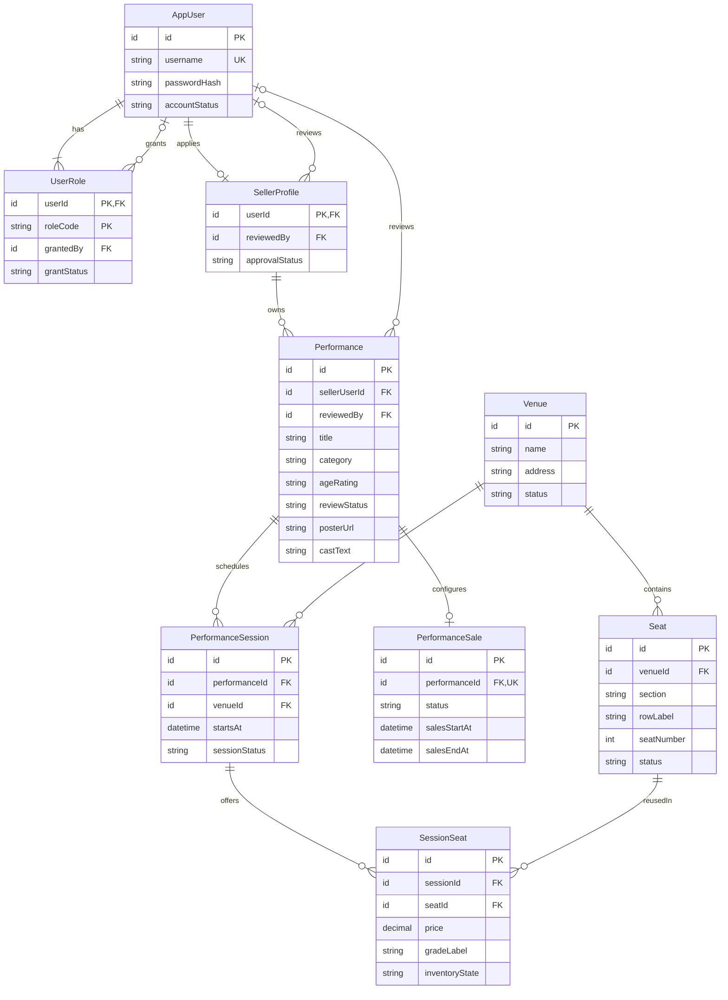
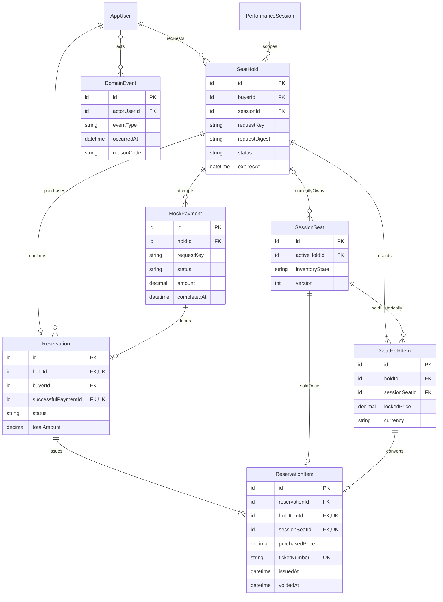

# 목표 논리 ERD 초안 — 2단계, 승인 전

작성일 2026-10-28. 기준 브랜치 `dev`, 커밋 `00a07d7db796e86e3f22f46d8d5bb9e0aa3d11ca`.
이 문서는 **대안 검토용 초안**이다. 이름·상태·테이블 수·제약·MVP 추가 범위를 확정하거나 마이그레이션을 승인하는 문서가 아니다. 코드·DB·기존 데이터는 변경하지 않았다.

## 근거와 정책 구분

- [AGENTS.md](../../AGENTS.md), [프로젝트 가이드](../../TICKETING_PROJECT_GUIDE.md), [현행 구조와 실측](current-schema-analysis.md), [차이 분석](schema-gap-analysis.md), [실측 보고서](../../reports/2026-10-28-db-metadata-verification.md)를 근거로 한다.
- **확정 요구 F**: Buyer/Seller/Admin, 판매자 소유 공연의 관리자 검수, 승인 전 비공개/판매 금지, 공개 목록·상세·회차·잔여 수·가격대, 개별 좌석부터 인증, Venue/Seat/SessionSeat 분리, 공연 공통 판매 정책, 기간 양끝 동시 null 또는 종료>시작, 모의 결제, 중복 유효 선점/확정 방지, 만료·실패 복구·멱등성.
- **현행 사실 C**: 7개 테이블, 6 FK, 4 UNIQUE, 1 enforced CHECK, 14 인덱스. role USER-only CHECK, 가격 decimal(38,2), 시간 datetime(6). 고아/중복 등 집계 0건, 판매 정책 없는 공연 1건. 근거는 이전 실측이며 이번 단계 DB를 다시 조회하지 않았다. Docker 컨테이너 동일성 독립 검증 제한도 그대로다.
- **제안 P**: 아래 신규 엔티티·속성·상태·취소/발급·승인 절차·복수 역할·동시성 구현 방식 전체. 사용자의 이번 검토 범위에 포함됐다는 것이 기존 서비스 정책으로 확정됐다는 뜻은 아니다.
- 가이드의 확정 후 재판매 금지는 **별도 취소 정책 승인 전 유지할 안전 기준**이다. 재판매를 허용하는 안으로 몰래 변경하지 않는다.

## 최소성 및 범위 제안

기존 7개 엔티티를 유지·확장한다. 검토용 그룹 선점안은 신규 8개로 총 15개 논리 엔티티다. 물리 테이블 수/이름은 미확정이다.

| 영역 | MVP 핵심 또는 제안 초안 | 이후 확장/조건부 대안 |
|---|---|---|
| 회원/권한 | 기존 AppUser, UserRole, SellerProfile 제안. 역할은 고정 코드로 Role 마스터 생략 | 조직 판매자·직원 소속·세부 권한/RBAC 마스터 |
| 콘텐츠 | 기존 Performance/Session/Venue, category enum 유지, posterUrl nullable, castText nullable | 다중 이미지, Artist/PerformanceCast, Category 마스터·복수 분류·회차별 출연진 |
| 좌석/판매 | 기존 Seat/SessionSeat/Sale. SessionSeat.gradeLabel은 선택 필드 제안, 가격은 좌석별 | SeatGrade/PricePlan은 등급별 일괄 편집·할인 요구가 승인될 때만 |
| 선점/예매 | SeatHold + SeatHoldItem, Reservation + ReservationItem, MockPayment | 다회차 장바구니, 부분 취소/재판매, 실 PG·환불/정산 |
| 티켓 | ReservationItem에 발급번호/시각 통합 제안. 별도 Ticket 테이블 없음 | 재발급 버전·입장 검표·양도·다중 소유권이 필요할 때 분리 |
| 이력 | DomainEvent 1개로 승인·역할·핵심 전이 기록 제안 | 모든 필드 revision, 외부 감사/CDC, 별도 outbox는 근거가 생길 때 |

SeatHoldItem은 해제 후에도 어떤 좌석을 어떤 금액으로 선점했는지 보존하고, 여러 좌석을 같은 만료/결제로 묶을 때 정당화된다. **MVP를 1선점=1좌석으로 제한**하면 Hold에 sessionSeatId/lockedPrice를 두고 Item을 생략하는 더 작은 대안이 있다. 그룹형을 초안에 그렸다고 다좌석 MVP를 확정한 것은 아니다(D2).

## Mermaid ERD

가독성을 위해 동일 모델을 두 영역으로 나눴다. `||` 정확히 1, `o|` 0..1, `o{` 0..N, `|{` 1..N이다. 후자의 최소 1개는 일반 FK만으로 보장되지 않아 트랜잭션 불변조건이 필요하다. nullable 여부와 제약은 아래 표가 우선하며, 그림의 논리 타입은 SQL/JPA 타입 확정이 아니다.

그림의 grants 관계는 부여자이며, 최초 관리자의 승인된 초기 등록에는 nullable을 허용하는 예외 후보를 표현한다. 일반 회원가입으로 ADMIN을 부여하지 않는다. 초기 등록 절차는 미확정이다.

DomainEvent의 대상별 FK는 그림을 복잡하게 하지 않도록 생략했으며 아래 표에 명시했다. `SessionSeat.activeHoldId`는 현재 점유자, HoldItem은 과거 좌석 목록이다. 두 값의 일치와 예매의 결제/선점 소속은 FK 한 개만으로 모두 증명되지 않는다.

## 엔티티별 주요 속성·키·관계

논리 ID는 기존 정수 PK 보존을 우선한다. 필수(NN), 선택(?) 표기. T는 업무 시각, A는 기록·감사 시각이다. 공통 시각을 무조건 상속시키지 않고 [수명주기 표](domain-lifecycle-policy.md)에서 엔티티별로 정한다.

| 엔티티 / 분류 | 주요 속성·필수성 | PK·FK·카디널리티·핵심 제약 |
|---|---|---|
| AppUser / 유지·확장 | username NN, passwordHash NN, accountStatus NN, withdrawnAt? | id PK, username UK. 회원 1명 : 역할 1..N(탈퇴/회수 후 유효역할 0 가능), 판매자 신청 0..1. USER→BUYER 해석·이행은 D1 |
| UserRole / 신규 제안 | roleCode BUYER/SELLER/ADMIN NN, grantStatus NN, grantedAt NN, grantedBy?, revokedAt? | PK(userId,roleCode), userId 및 grantedBy→AppUser. 재부여는 동일 행 갱신+event. 자동 ADMIN 가입 금지 |
| SellerProfile / 신규 제안 | approvalStatus NN, submittedAt?, reviewedAt?, reviewedBy?, reasonCode? | userId PK/FK→AppUser, reviewedBy→AppUser. APPROVED와 유효 SELLER 권한 모두 요구; 자기 승인 금지 제안 |
| Performance / 유지·확장 | 기존 title/description/category/ageRating, sellerUserId NN(목표), reviewStatus NN, reviewedBy?, submittedAt?, reviewedAt?, contentVersion NN, reviewedVersion?, posterUrl?, castText?, archivedAt? | id PK, sellerUserId→SellerProfile, reviewer→AppUser. 카테고리 1개 코드, 출연진 자유 표시문자열, 이미지 없으면 기본 이미지. 기존 소유자 backfill 미결정 |
| PerformanceSession / 유지·확장 | performanceId NN, venueId NN, startsAt NN, endsAt?, sessionStatus NN, cancelledAt? | id PK, 공연/공연장 각 N:1. endsAt 사용 시 >startsAt. 장소 중복 시간 차단은 종료/운영 규칙 확정 후 |
| Venue / 유지·확장 | name/address NN, status ACTIVE/RETIRED NN, retiredAt? | id PK, Seat·Session 각각 0..N. 기존 거래 참조 시 삭제 금지 |
| Seat / 유지·확장 | venueId/section/rowLabel/seatNumber NN, status NN, retiredAt? | id PK, venue FK, UK(venueId,section,rowLabel,seatNumber) 유지. 위치 변경으로 과거 발권표시가 변하지 않게 snapshot 보존 |
| SessionSeat / 유지·확장 | sessionId/seatId/price NN, currency NN 제안, gradeLabel?, inventoryState NN, activeHoldId?, version NN | id PK, UK(sessionId,seatId) 유지, activeHoldId→SeatHold. 회차 Venue=Seat Venue. HELD일 때만 activeHold NN. CONFIRMED의 거래는 Item으로 추적 |
| PerformanceSale / 유지·강화 | performanceId/status NN, salesStartAt?/salesEndAt?, updatedAt A | id PK, performanceId FK+UK. 초안 작성 중 0..1, 판매 가능한 승인 공연은 정확히 1건. 기간 pair/order CHECK 후보, 상태 NOT NULL 후보 |
| SeatHold / 신규 제안 | buyerId/sessionId NN, status NN, expiresAt T NN, requestKey/digest NN, releasedAt?/expiredAt?/confirmedAt?, terminalReasonCode? | id PK, buyer/session FK. UK(buyerId,requestKey), 동일 요청 키는 정렬된 좌석집합·회차·작업과 digest 결합. 항목 1..N, 하나의 회차만 |
| SeatHoldItem / 신규 제안 | holdId/sessionSeatId NN, lockedPrice/currency NN, grade/seatLabel snapshot? | id PK, 두 FK, UK(holdId,sessionSeatId). 영구 UK(sessionSeatId)는 금지: 만료 후 새 선점 허용. 생성 이후 불변 |
| Reservation / 신규 제안 | holdId/buyerId/successfulPaymentId/totalAmount/currency NN, status NN, confirmedAt NN, cancelKey?/cancelDigest?, cancelledAt?, cancelReasonCode? | id PK, 각 FK, holdId UK, successfulPaymentId UK. **성공 확정 시에만 생성**. 미확정 구매 시도는 Hold/Payment에서 조회 |
| ReservationItem / 신규 제안 | reservationId/holdItemId/sessionSeatId NN, purchasedPrice/currency NN, seatLabel/grade/sessionStart snapshot NN 또는 선택정책, ticketNumber NN, issuedAt NN, voidedAt? | id PK, 3FK, holdItemId UK, sessionSeatId UK, ticketNumber UK. 확정 시에만 생성. 이 전역 좌석 UK는 확정 후 재판매 금지 전제에 한함(D4) |
| MockPayment / 신규 제안 | holdId/requestKey/digest NN, status NN, amount/currency NN, requestedAt NN, completedAt?, failureCode?, reversedAt? | id PK, hold FK, UK(holdId,requestKey). hold 1 : attempt 0..N. 성공 attempt는 Reservation.successfulPaymentId로 한 번만 사용. 결제 자격증명·카드 데이터 없음 |
| DomainEvent / 신규 제안 | eventType/fromState?/toState?/occurredAt NN, actorUserId?, actorKind NN, reasonCode?, correlationId, aggregateVersion | id PK, actor FK nullable(system). 대상 FK 중 정확히 하나 NN: userId→AppUser, sellerUserId→SellerProfile, performanceId, sessionId, venueId, seatId, sessionSeatId, saleId, holdId, reservationId, paymentId→각 엔티티. DB CHECK 후보로 정확히1 검증; 다형 targetType/targetId만 두지 않음 |

DomainEvent는 핵심 상태/승인/가격 변경의 증거 후보다. 역할 변경은 roleCode 선택 속성을 반드시 함께 기록하며, 같은 회원의 BUYER/SELLER/ADMIN 변경을 구분한다. 가격/등급/일정 값 이력을 요구하는 event에는 선택 typed 속성 oldAmount/newAmount/currency, oldGradeLabel/newGradeLabel, oldStartsAt/newStartsAt, oldEndsAt/newEndsAt을 eventType별 허용 목록으로 제안한다. 자식 불변 Item 생성/티켓 무효화는 부모 Reservation/Hold 대상 event로 추적한다. 자유 JSON/요청 본문/민감값은 저장하지 않는다. 이 범위 밖 제목·설명·장소/좌석 표기 변경은 발생 메타데이터만 기록하며 전체 과거 내용 복원은 보장하지 않는다. 전체 콘텐츠 revision이 필요하면 D7에서 범위를 늘려야 한다.

11개 선택 대상 FK와 sparse typed 속성은 비용이 있으므로 이 공통 이력안을 무조건 최소 구현이라고 단정하지 않는다. 도메인별 전용 이력안은 테이블은 늘지만 필수 필드·FK 검증이 명료해진다. D7 승인 전 두 안의 비용을 비교한다.

가격의 양수 조건은 현행 DTO 정책을 보존한다. 무료 좌석 허용·KRW 단일 여부·정밀도 상한은 D5다. 현재 DB decimal(38,2)를 승인 없이 축소하지 않는다. posterUrl에는 공개 정적 자원 식별자만 허용하고 만료 서명·API 키가 포함된 URL은 모델에 저장하지 않는 제안이다.

## 정합성 불변조건과 적용 계층

| 불변조건 | 보장 후보 및 한계 |
|---|---|
| 동일 회차/물리좌석 현재 재고 1행 | SessionSeat UK(sessionId,seatId)와 PK 유지 |
| 동시에 유효한 점유 최대 1개 | SessionSeat 단일 현재 점유 포인터+조건부 갱신 또는 행 락. Hold의 ACTIVE 행이 여러 개 있어도 같은 좌석의 유효 포인터는 한 개. 만료 및 소유권 조건을 명령마다 재검증 |
| 같은 물리좌석 다른 회차는 독립 | Hold/Payment/Reservation은 회차별 SessionSeat ID로 연결. 물리 Seat에 재고 상태를 두지 않음 |
| 묶음 내 회차·회원·통화 일치 | Hold.sessionId=모든 HoldItem의 SessionSeat.sessionId, Reservation.buyerId=Hold.buyerId, Payment.holdId=Reservation.holdId, Item은 같은 hold에 속함. 트랜잭션 검증 및 필요 복합 FK를 물리설계에서 비교 |
| 같은 공연장만 연결 | SessionSeat가 참조하는 Session과 Seat의 venue 동일. 복합 FK용 venueId 중복 보유안과 서비스 불변 관계 고정안을 비교; 일반 CHECK로 다른 테이블 비교가 가능하다고 가정하지 않음 |
| 가격 합계 불변 | HoldItem 금액 snapshot 합=Payment.amount=Reservation.total=sum(Item.purchasedPrice), 통화 일치. 다중 행 합계는 일반 CHECK가 아닌 트랜잭션 검사 |
| 한 선점의 성공 예매/결제 1건 | Reservation.holdId UK, successfulPaymentId UK + Hold 직렬화. 두 attempt 동시 성공 전이 차단. Item UK(sessionSeatId)는 확정 후 재판매 금지 보조 제약 |
| 티켓과 예매 일치 | 확정·좌석 전환·모의 결제 성공·Item 발급정보 생성은 동일 로컬 DB 트랜잭션. 티켓번호는 인증 권한 대신 사용하지 않음 |
| 상태·이력 함께 기록 | 핵심 변경과 DomainEvent 저장 같은 트랜잭션, append-only 권한/보존정책 필요. updatedAt만으로 이력을 대체하지 않음 |
| 승인/판매/소유권 변경과 구매 경합 | 재고 명령 시 회원·판매자·공연 검수·판매 상태를 권위 데이터로 재검증. 대상 정책 행도 락 또는 조건 버전 비교로 상태 변경과 직렬화; 단순 사전 SELECT만으로 충분하지 않음 |

만료/결제 실패·재시도·취소 경쟁, 락 비교 및 상태표는 [수명주기 초안](domain-lifecycle-policy.md)에 기술한다. 이 표는 구현으로 입증한 보장이 아니다.

## 기존 스키마 대비 변경 후보

| 기존 | 유지/수정 후보 | 이행 시 주의 |
|---|---|---|
| app_user의 role USER 문자열/USER-only CHECK | AppUser + UserRole, 기존 USER를 BUYER로 해석하는 mapping 후보 | 역할 bootstrap·CHECK 전환·기존 principal/API 호환과 rollback 동시 검토 |
| performance 23건, 소유자/검수 없음 | sellerUserId/검수/version/선택 콘텐츠 확장 | 기존 데이터를 자동 APPROVED/판매자 소유로 간주하지 않음. 확인 전 비공개 처리안은 별도 승인 필요 |
| performance_session 49건 | 일정 상태/선택 종료시각·감사 추가 | 실제 startsAt·FK 보존, 이미 잡힌 좌석의 일정 변경 정책 필요 |
| venue 8 / seat 72 | 위치·관계 유지, 퇴역과 거래 snapshot | 참조 자료 cascade 삭제 금지 |
| session_seat 480 | 관계/가격 유지, 현재 재고·선점 연결·version 추가 | 예매 도입 전 재고 초기 상태를 검증하고 기존 데이터 임의 초기화 금지 |
| performance_sale 22 / 공연 23 | 공연별 UK 유지, status NN/기간 CHECK 후보 | 정책 없는 1건은 아래 별도 처리, null기간 판매 정책 D5 |
| 없음 | 8 신규 논리 엔티티 제안 | 단계별 최소 수직 흐름으로 추가. 일괄 CREATE/엔티티 재작성 지시 아님 |
| 신규 제안의 물리 DDL 미설계 | enum/시간/금액 명시, 필요한 FK/인덱스/마이그레이션 | 기존 실제 스키마 baseline 및 비파괴 이행 리허설 후 DDL 검토 |

별도 Category/Image/Artist/Grade/Ticket/Cancel/Refund/Role 마스터 테이블은 본 MVP 초안에서 늘리지 않았다. 취소는 Reservation 상태와 MockPayment 결과 전이로 표현한다. 부분취소·환불 상세원장은 현재 요구로 확정하지 않았다.

## 판매 정책 없는 공연 1건 — 원인 및 처리 후보

- **확인 사실**: 이전 실측에서 performance 23, performance_sale 22, LEFT JOIN 집계상 정책 없는 공연 1건이다. 현 서비스는 정책이 없으면 판매 불가(false)를 반환한다.
- **구조적 가능 원인**: PerformanceService.create는 공연만 저장하며 Sale 생성은 별도 서비스/API다. FK/UK는 Sale→공연의 존재와 최대 1건만 강제해 공연→Sale 필수 존재를 강제하지 않는다. 따라서 정책 생성 전 초안은 구조적으로 가능하다.
- **그 1건의 실제 역사적 원인**은 미확인이다. 초기 수동 등록/미완료 작업/과거 삭제 중 무엇인지 로그 증거가 없다. 특정 원인·사용자·ID·개인정보를 추정해 기록하지 않는다. 이번 단계 추가 DB 조회도 하지 않았다.

| 처리 후보 | 장점 | 위험/승인 필요 |
|---|---|---|
| 누락 상태 유지, 작성 중/판매 불가로 취급 | 임의 데이터 생성 없음 | 현재 공개 노출은 별도 검수 정책과 충돌 가능; 사용자 승인 후 명세화 |
| 소유자가 명시적으로 PREPARING 정책 등록 | 가격/일정/판매 책임 확인 가능 | 소유자부터 확인해야 함. 신규 정책 작성은 이번 작업 범위 밖 |
| 공연 생성 시 PREPARING Sale 동시 생성, 기존 1건은 별도 검토 | 향후 누락 예방, 승인·오픈을 안전 기본값과 분리 | 자동 보정/삭제가 아니며 기존 이행·API 호환은 승인 필요 |

OPEN 자동 삽입, 판매 기간 추정, 공연 삭제는 후보로 채택하지 않는다. 논리 ERD는 작성 중 0..1을 허용하고 **판매 승인/오픈 직전 정확히 1개**를 검사하는 안을 제안한다. 작성 중부터 항상 1개를 요구하는 대안도 D5에서 결정한다.

## 승인해야 할 주요 설계 결정

| ID | 결정 | 초안 제안 / 대안 | 영향 |
|---|---|---|---|
| D1 | 복수 역할·판매자 신청 승인·관리자 부여 | Buyer 유지+Seller 추가, SellerProfile 승인, Admin은 승인된 별도 초기화 / 단일 role 유지 | UserRole/SellerProfile 필요성, USER CHECK 이행·자기승인 금지·회수 시 세션/진행 거래 처리 |
| D2 | 선점 단위·TTL·가격 고정 시점 | 같은 회차 다좌석 원자 묶음+선점 시 snapshot / MVP 1좌석으로 Item 생략. TTL 숫자는 미정 | 테이블 수·입력 제한·동시성·만료 UX |
| D3 | 결제 성공/확정의 경계·판매 종료와 진행 선점 | 로컬 모의 결제 성공과 예매/발급 동시 commit, 확정 때도 유효한 판매 조건 요구 / 유효 선점에 유예권 부여 | 만료 경합·실패 코드·기간 경계와 처리 우선순위 |
| D4 | 취소 허용 범위·재판매·티켓 무효화 | 취소는 조건부 전체 예매만, 재판매 금지 유지 / 부분취소·재판매는 후속 설계 | Item 영구 UNIQUE(sessionSeatId) 채택 여부, 환불·티켓 모델 |
| D5 | 무기간 OPEN·판매정책 필수 시점·가격/시간 기준 | 현재 OPEN+양끝null 동작 보존 후보, 승인/OPEN 전 Sale 필수, 양수가격 유지 / 무기간 판매 금지 등은 별도 변경승인 | 누락 1건, 경계시각·무료좌석·통화/정밀도·UTC 전환 여부 |
| D6 | 검수 후 변경·콘텐츠/등급 범위 | version 기반 재검수, poster 1개/castText/gradeLabel / 복수 이미지·출연진·등급 마스터 | 판매 중 변경 중단, 기존 공연 소유·승인 backfill |
| D7 | 이력·탈퇴·삭제·보존 | 최소 DomainEvent+도메인별 retired/withdrawn, 거래 삭제 금지 / 전용 이력 분리 | 개인정보 비식별화와 FK 보존·감사 접근·보존기간 |
| D8 | 경쟁 제어 구현 | 행락 기준안과 조건부 갱신/낙관적 version 비교 | 코드 작성 전 별도 계획·100사용자 실제 DB 테스트·deadlock 재시도 정책 승인 |

모든 D 항목은 미승인이다. 관계/상태의 실행 가능성을 검토한 초안이며 테이블을 실제 생성하거나 현재 정책을 변경할 근거로 사용하지 않는다.
